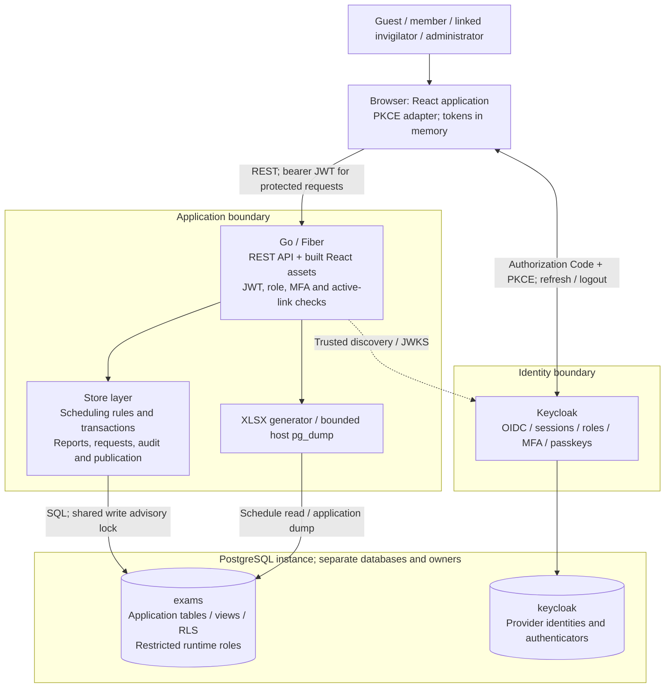
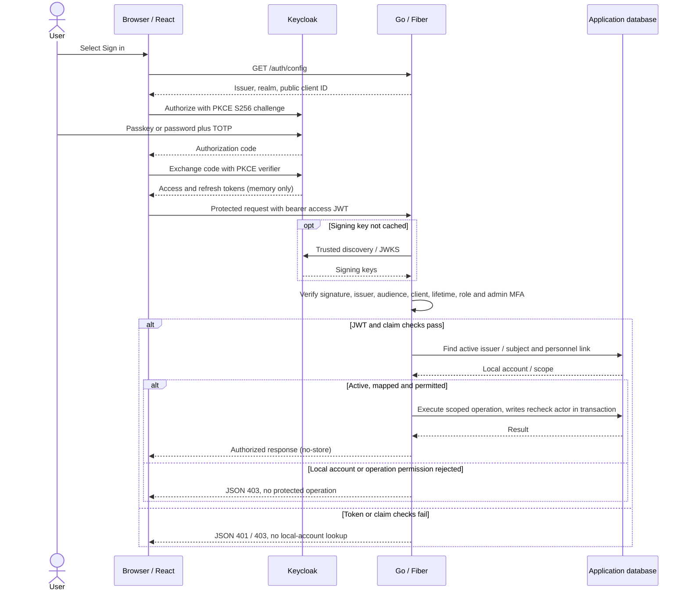

# Architecture and security

This is the implemented architecture at the [documentation baseline](README.md).

## System context

Local development uses loopback HTTP; production requires API TLS and an HTTPS issuer. Compose runs PostgreSQL and Keycloak. The existing [Graphviz overview](architecture.dot) also depicts the high-level topology.

## Components and ownership

| Component | Responsibility | Source |
| --- | --- | --- |
| React application | Published timetable, resource forms, role-specific workspaces, account state, reports, downloads, and accessible interaction. Vite serves development assets; Tailwind supports styling. | [frontend/src](../frontend/src/), [package.json](../frontend/package.json) |
| Browser identity adapter | Keycloak Authorization Code + PKCE S256, refresh/logout, and in-memory access/refresh tokens. | [auth.js](../frontend/src/auth.js), [account.jsx](../frontend/src/account.jsx) |
| Go/Fiber API | Routing, strict input/representation validation, authentication/authorization, JSON errors, request IDs, security headers, and static SPA serving. | [internal/api](../backend/internal/api/), [cmd/server](../backend/cmd/server/) |
| Domain and persistence | Scheduling rules, transaction ownership, room/staff selection, requests, SQL queries, reports, and transactional audit/publication. | [internal/store](../backend/internal/store/) |
| Download implementations | Literal-cell two-sheet XLSX generation and bounded host `pg_dump` invocation. | [internal/xlsx](../backend/internal/xlsx/), [internal/backup](../backend/internal/backup/) |
| PostgreSQL | Relational constraints, application views, request row policies, transactions, and advisory locks. `exams` and `keycloak` have separate owners. | [migrations](../backend/migrations/), [bootstrap](../infrastructure/postgres-init.sh) |
| Keycloak | Identity lifecycle, MFA/passkeys, role claims, sessions, JWT issuance, and signing-key discovery. No application password store. | [realm configuration](../infrastructure/exams-realm.json), [provisioning](../backend/internal/provision/) |
| Operator commands | Setup, migrations, safe demo seed/provisioning, server/web launch, and tests. They are explicit commands, not destructive startup hooks. | [scripts](../scripts/), [backend/cmd](../backend/cmd/) |

The backend is one application with internal packages. Frontend, API, and provider are independently started in development; a compiled Go server can serve the React build and API from one origin. Compose starts PostgreSQL and Keycloak, not the Go/React processes. This product has no queue, cache service, background scheduler, or microservice topology.

## Main data paths

1. Public schedule reads use the reader pool and the sanitized `published_schedule` view. SQL applies stable ordering, filters, count, and pagination in one statement.
2. Authenticated requests verify the bearer JWT and load its active local `(issuer, subject)` link. API permission checks decide which service/pool can run.
3. Administrator domain writes use `Scheduler.mutate`: begin transaction, acquire schedule lock, recheck active actor, apply the change, validate final state, invalidate publication when needed, append audit, and commit. Failure rolls back the transaction.
4. Invigilator requests use the restricted pool with transaction-local `app.personnel_id`; SQL row policies and column grants enforce ownership and pending-only writes. These writes share the schedule lock and append audit atomically.
5. Reports reuse persisted joins and domain availability rules. XLSX uses one matching schedule snapshot for both sheets. Backups use the configured application administrator database connection and stream only a completed archive.

## Authentication sequence

The sequence shows a successful provider login followed by API authorization. Invalid JWTs are rejected before the local-account lookup; database lookup failures return a sanitized 503.

Go accepts RS256 bearer access tokens for audience `exam-api`, authorized party `exam-web` or `exam-postman`, the configured issuer, and a nonempty subject. Signature, expiry and issued-at checks use a 30-second clock allowance. Signing keys come from same-origin trusted discovery/JWKS endpoints and are cached. An administrator role additionally requires signed `amr` evidence for a passkey or both password and OTP. A linked invigilator needs the permission plus an active local personnel mapping.

Access/refresh tokens remain in browser memory. Temporary login/PKCE state is held by the adapter in browser storage; theme preferences are also stored locally. Reload requires selecting Sign in again. Refresh tokens rotate and logout ends the provider session, but an already-issued access JWT may remain usable for its five-minute lifetime plus clock allowance. Disabling the local application account blocks subsequent authenticated access immediately.

## Trust boundaries and controls

| Boundary / data | Enforcement |
| --- | --- |
| Browser → application | Treat input and client roles as untrusted. Strict body/filter validation, parameterized SQL, server permissions, and request-size limits. Unknown `/api` routes return JSON 404 rather than SPA HTML. |
| Browser → identity provider | Authorization Code + PKCE; provider authenticates credentials/MFA. App and provider operator identities are separate. Self-registration and email reset are disabled in the delivered realm. |
| JWT → local authorization | Trusted issuer/signature/audience/client/lifetime, signed roles/MFA, then active application identity and personnel link. Writes recheck the actor inside the transaction. |
| API → application database | Separate `exam_reader`, `exam_admin`, and `exam_invigilator` pools. Owner credentials are reserved for schema operations. Invigilator identity is transaction-local, preventing pooled-connection identity leakage. |
| Application → identity storage | Separate database and `keycloak_owner`; application roles have no provider database access. |
| Public → private data | Public view includes exam/course/department/session/room information, omitting personnel, requests, account links, and audit. Authenticated responses use `Cache-Control: no-store`. |
| Process → backup client/files | Fixed `pg_dump` command without a shell or caller-supplied paths; private temporary files and credential handling; bounded output/time; cleanup on failure/disconnect. |
| Network → deployed services | Local HTTP is limited to loopback development. Production configuration requires API TLS and an HTTPS issuer. CSP, frame restrictions, content-type protection, and referrer policy supplement authentication. |

## Implementation decisions and tradeoffs

These explain the current design; they are not reconstructed historical decision records.

| Decision | Fit and consequence |
| --- | --- |
| One Go domain owner | Manual and automatic scheduling share validation/transactions. Fixing an invariant belongs here rather than in each form or endpoint. |
| Database advisory lock | Serializes cooperating scheduling writers before rule reads. This favors correctness and simple rollback; write throughput and whole-schedule validation must be measured before claiming scale. Direct SQL can bypass service rules. |
| Deterministic planning/staffing | Predictable, testable course/session/department/workload ordering. Planning may fail even when another ordering is feasible; it is not an exhaustive solver. |
| External identity provider | Keycloak owns password/MFA/signing state; application authorization still depends on local active links. Recovery must retain compatible provider state separately. |
| SQL views and restricted pools | Data visibility is enforced below the UI. They complement, rather than replace, API authorization. |
| Same-origin compiled delivery | Go serves built assets and API without another application server. The identity provider remains a separate origin/service. |

Operational procedures are in [operations.md](operations.md); precise schema and rules are in [data-model.md](data-model.md) and [workflows.md](workflows.md).
