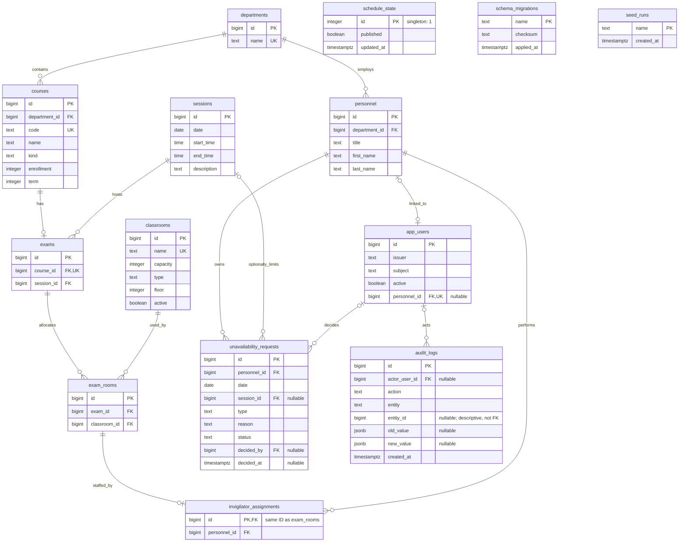

# Data model and dictionary

The [SQL migrations](../backend/migrations/) define the executable application schema. This document covers the 12 domain/control tables plus `schema_migrations` and `seed_runs`: **14 application tables**. Keycloak's internal tables belong to its separate database and are outside this schema.

## Entity relationship diagram

The ER diagram shows database cardinalities, including empty/unpublished schedules. `app_users.personnel_id` is nullable and unique: an account may link to zero or one person; a person may have zero or one account. Composite unique constraints, cascade behavior, and service-level requirements appear below. `schedule_state`, `schema_migrations`, and `seed_runs` have no foreign-key relationships.

## Types and conventions

`PK` is primary key, `FK` foreign key, and `UQ` unique. Unless marked nullable, a column is `NOT NULL`. IDs are `bigint GENERATED BY DEFAULT AS IDENTITY`, except assignment IDs (shared allocation PK), audit IDs (`GENERATED ALWAYS`), and the singleton schedule ID (`integer`). Dates and session `time` values represent faculty wall time in **Europe/Istanbul**; audit/decision/control timestamps are `timestamptz`, displayed/filtered as UTC where specified. API IDs are JSON integers; XLSX writes IDs as text to preserve digits.

## Reference and identity tables

| Table | Columns and database constraints |
| --- | --- |
| `departments` | `id bigint PK`; `name text UQ`, trimmed length 1–100. |
| `courses` | `id bigint PK`; `code text UQ`, trimmed length 1–20; `name text`, trimmed length 1–100; `kind text` ∈ `mandatory`, `elective`; `enrollment integer > 0`; `term integer` 1–8; `department_id bigint FK → departments.id`. |
| `classrooms` | `id bigint PK`; `name text UQ`, trimmed length 1–50; `capacity integer > 0`; `type text`, trimmed length 1–50; `floor integer`; `active boolean DEFAULT true`. |
| `sessions` | `id bigint PK`; `date date`; `start_time time`; `end_time time`; `description text DEFAULT ''`; check `start_time < end_time`; UQ `(date, start_time)`. Cross-session non-overlap is a service rule. |
| `personnel` | `id bigint PK`; `title text`; `first_name text` and `last_name text`, each trimmed length 1–100; `department_id bigint FK → departments.id`. |
| `app_users` | `id bigint PK`; `issuer text`; `subject text`; `active boolean DEFAULT true`; nullable `personnel_id bigint UQ FK → personnel.id`; UQ `(issuer, subject)`. Roles/passwords/authenticators are not columns here. |

API validation adds field presence, length, date/time, and encoding checks beyond these SQL constraints; for example, title is bounded to 100 characters and session description to 500. See [inputs.go](../backend/internal/api/inputs.go). Do not infer that all API validation is represented by SQL checks.

## Schedule and request tables

| Table | Columns and database constraints |
| --- | --- |
| `unavailability_requests` | `id bigint PK`; `personnel_id bigint FK → personnel.id`; `date date`; nullable `session_id bigint FK → sessions.id`; `type text` ∈ `leave`, `medical`, `advisory`; `reason text`, trimmed length 1–500; `status text DEFAULT 'pending'` ∈ `pending`, `approved`, `rejected`; nullable `decided_by bigint FK → app_users.id`; nullable `decided_at timestamptz`. Check: pending has neither decision field; approved/rejected have both. |
| `exams` | `id bigint PK`; `course_id bigint UQ FK → courses.id`; `session_id bigint FK → sessions.id`. One exam per course in the current database. |
| `exam_rooms` | `id bigint PK`; `exam_id bigint FK → exams.id ON DELETE CASCADE`; `classroom_id bigint FK → classrooms.id`; UQ `(exam_id, classroom_id)`. This is an exam's room allocation, not a public CRUD resource. |
| `invigilator_assignments` | `id bigint PK FK → exam_rooms.id ON DELETE CASCADE`; `personnel_id bigint FK → personnel.id`. The shared ID permits at most one duty per allocated room and has no separate sequence. |
| `schedule_state` | `id integer PK CHECK (id = 1)`; `published boolean DEFAULT false`; `updated_at timestamptz DEFAULT now()`. Migration inserts the singleton row. |

When `session_id` is present on a request, the service derives `date` from the selected session. When absent, `date` identifies a whole-day request. Only approved requests block duties. Pending-only edits, immutable ownership, request/session date agreement, capacity, conflicts, and duty/cohort limits are enforced in the service layer; see [business rules](workflows.md).

## Audit and lifecycle metadata

| Table | Columns and role |
| --- | --- |
| `audit_logs` | `id bigint GENERATED ALWAYS AS IDENTITY PK`; nullable `actor_user_id bigint FK → app_users.id`; `action text`; `entity text`; nullable `entity_id bigint`; nullable `old_value jsonb`; nullable `new_value jsonb`; `created_at timestamptz DEFAULT now()`. Entity IDs are descriptive, not foreign keys, so history can retain deleted record identifiers. Batch snapshots may include multiple records. |
| `schema_migrations` | `name text PK`; `checksum text`; `applied_at timestamptz DEFAULT now()`. Created by the migration runner; SHA-256 protects already-applied SQL from silent edits. |
| `seed_runs` | `name text PK`; `created_at timestamptz DEFAULT now()`. Records completed demo seed runs so reruns preserve later edits. |

No domain API mutates identity links, audit history, migration markers, or seed markers directly. Identity links are managed by provisioning/operator procedures. The application administrator database role has append/read audit access, not audit update/delete privileges.

## Relationships and deletion

| Parent | Children / cardinality | Effect when parent is deleted |
| --- | --- | --- |
| Department | 0..many courses and personnel; each child requires one department. | Existing child references block deletion. |
| Course | 0..1 exam; each exam has one course. | An existing exam blocks course deletion. |
| Session | 0..many exams and optional session-specific requests. | Existing references block deletion. |
| Classroom | 0..many allocations over different sessions. | Existing allocations block deletion. |
| Exam | 0..many allocations at SQL level; valid scheduled exams require sufficient capacity. | Allocations cascade; their duties cascade too. |
| Allocation | 0..1 invigilator assignment. | Its assignment cascades. Publication requires exactly one assignment for every allocation. |
| Personnel | 0..many duties/requests; 0..1 linked application account. | Existing references block deletion. |
| Application user | 0..many decisions/audit records; each decision/audit actor is optional at schema level as described above. | Existing references block deletion; normal account disabling preserves history. |

Foreign keys without an explicit cascade use PostgreSQL's default `NO ACTION`. **Clear schedule** deletes exams, cascading allocations/duties, and resets publication; it retains courses, other reference data, requests, application users, and audit history. Reallocating an exam preserves unchanged allocation IDs/duties; removed allocations lose only their own duties.

## Views and access paths

| View | Contents and visibility |
| --- | --- |
| `current_schedule` | Course/department/session/room projection for all exams; administrator export source. Omits private personnel/request data. |
| `published_schedule` | Same projection, returning rows only while singleton publication is true. Reader, invigilator, and administrator can select it. |
| `invigilator_workload` | Personnel plus duty counts, including zero-duty personnel; administrator-readable. Filtered reports additionally use dedicated queries. |
| `own_duties` | Security-barrier view of the current invigilator's duties, including unpublished work, selected using transaction-local `app.personnel_id`. |
| `own_personnel` | Security-barrier view of that same personnel identity for the personal workload summary. |

The invigilator role's request row policies permit only its own rows. INSERT/UPDATE grants exclude decision fields; UPDATE/DELETE policies require pending status. The service also enforces these rules for administrators. `app.personnel_id` is set for the transaction, not persisted on the pool connection.

Indexes support course/personnel department lookups, session date ordering, personnel/date requests, exam sessions, room/personnel assignment lookups, and audit time ordering. PK/UQ constraints supply their own indexes. These indexes are implementation facts, not a benchmark claim.

## Schema evolution and recovery

Migrations are embedded in Go, applied in filename order in one advisory-locked transaction, and recorded with checksums. Add a numbered migration for any change. There is no automatic down-migration command. Review backward compatibility and backup/restore before applying a change that cannot be reversed by deploying the previous binary.

An application backup includes all 14 tables, sequences, views/policies/grants, and identity links. It excludes PostgreSQL cluster roles/passwords and the entire Keycloak database. Recovery requires compatible external role/configuration/provider state; see [operations.md](operations.md).
