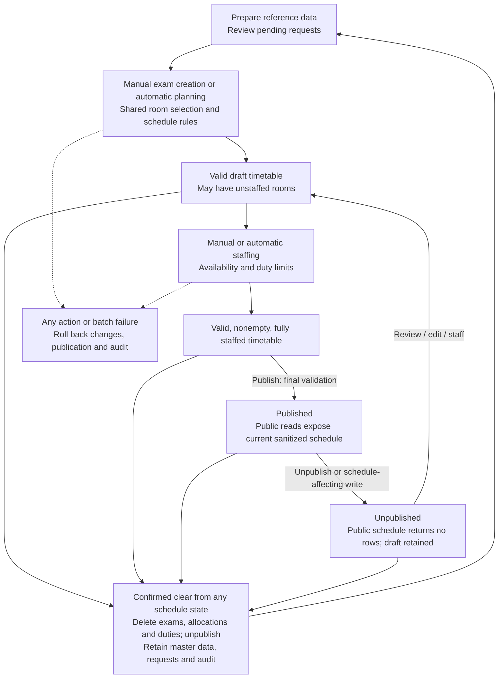

# Workflows and business rules

These rules describe existing behavior, owned by [store/rules.go](../backend/internal/store/rules.go), [scheduler.go](../backend/internal/store/scheduler.go), [automatic.go](../backend/internal/store/automatic.go), and [requests.go](../backend/internal/store/requests.go).

## Prepare, plan, staff, publish

Draft, staffed, and empty describe derived conditions; only the publication flag is persisted as a lifecycle state. Valid request decisions and planning/staffing batches with no changes preserve publication.

1. The administrator maintains departments, courses, active rooms, sessions, and personnel, and reviews pending unavailability requests.
2. Create an exam by choosing a course/session, or run automatic planning for unplanned courses. Rooms are selected by the shared allocation rules. Existing exams remain during automatic planning.
3. Create a duty for an allocation manually or run automatic staffing for all unstaffed allocations or one allocation. An assignment ID is the allocation ID.
4. Review dashboard issues and workload/availability. A draft may contain unstaffed rooms; it must satisfy the other schedule rules.
5. Publish a nonempty, valid timetable once every allocation is staffed. Public reads immediately reflect its current projection. This is a visibility switch, not a saved version or immutable snapshot.
6. Unpublish to hide the timetable. Schedule-affecting mutations also unpublish in their transaction. After a successful edit, review and publish again.

## Schedule invariants

| Rule | Required behavior |
| --- | --- |
| Session ordering | Sessions sort by date, start time, then ID. Each ends after it starts; sessions on the same date cannot overlap. Gaps/consecutive rules use positions in this session list, not elapsed minutes. |
| Course uniqueness | At most one exam per course. |
| Cohort | A cohort is department + term. It has at most two exams per date and at least one intervening free session between them. Mandatory and elective courses use the same cohort rule. |
| Room reservation | A room is active and allocated at most once per session. An exam's combined allocated capacity covers course enrollment. |
| Room selection | Use the minimum number of free active rooms by descending capacity, with ID as tie-breaker. Prefer the lowest-numbered single floor that can cover enrollment with that same minimum count; otherwise use the capacity-ranked selection across floors. |
| Duty uniqueness | Each allocation has at most one invigilator; each person has at most one duty in a session. Publication requires every allocation to have a duty. |
| Approved unavailability | An approved whole-day request blocks every session on that date; an approved session request blocks its selected session. Pending/rejected requests do not block duties. |
| Staff limits | A person has at most four duties per date and cannot cover four consecutive sessions on that date. Three consecutive duties are allowed. |
| Publication | At least one exam and full valid staffing are required. All other schedule invariants still hold. |

Manual exam replacement reallocates rooms. Unchanged allocation rows retain their duties; deleted allocation rows cascade only their own duties. Linked master edits are validated against the resulting schedule; a changed capacity, enrollment, session, or personnel relationship cannot commit an invalid final state.

## Automatic algorithms and failure behavior

**Planning** considers unplanned courses in ascending ID order, optionally restricted to odd (autumn) or even (spring) terms. It tries sessions chronologically and takes the first placement passing the shared rules. The entire operation rolls back if any target cannot be placed. Because it does not backtrack through every ordering, failure does not prove that no feasible timetable exists; a different manual ordering may work.

**Staffing** visits allocations in ID order, skipping existing duties for scope `all`. It ranks eligible personnel by same course department first, total current duty count next, then personnel ID. A successful choice affects the next choice's workload/availability. Failure for any target rolls back the batch. Scope `one` rejects an already-staffed allocation. A successful batch with zero changes leaves publication intact.

## Request lifecycle

```mermaid
stateDiagram-v2
    [*] --> Pending: Create for self / administrator-selected person
    Pending --> Pending: Edit date, session, type or reason
    Pending --> Pending: Approval conflicts with duty, rollback
    Pending --> Approved: Administrator approves; final state valid
    Pending --> Rejected: Administrator rejects
    Pending --> Withdrawn: Delete own pending / administrator deletes pending
    Approved --> [*]
    Rejected --> [*]
    Withdrawn --> [*]
    note right of Pending
        Owner is immutable.
        No decision metadata while pending.
        Other owners' records are concealed.
    end note
    note right of Approved
        Deciding actor and time recorded.
        Approved/rejected cannot be edited,
        withdrawn, reopened or decided again.
    end note
    note left of Withdrawn
        Deleted row; audit retained.
        Withdrawal is not a stored status.
    end note
```

| Action | Actor / precondition | Result |
| --- | --- | --- |
| Create | Administrator for a personnel record, or linked invigilator for self. | Pending request with no decision metadata. A selected session supplies its date; otherwise a valid whole-day date is required. |
| Read/list | Administrator across requests; invigilator within own scope. | Other owners' records are concealed from invigilators. |
| Replace | Pending request; invigilator must own it. | Editable date/session/type/reason change; owner and decision fields cannot change. |
| Withdraw/delete | Pending request; invigilator must own it. | Request row is deleted and its old value retained in audit. Withdrawal is not a persisted status. |
| Approve | Administrator; pending request and valid resulting duties. | `approved`, deciding local user, and timestamp commit together. Existing duty conflict aborts; request remains pending. |
| Reject | Administrator; pending request. | `rejected`, deciding local user, and timestamp commit together. |
| Edit/delete/decide reviewed request | Status already approved/rejected. | Conflict; no mutation. There is no reopen action. |

Pending request writes and valid decisions do not invalidate publication. Approval must validate against current duties under the shared write lock, so it cannot publish or preserve a conflicting schedule.

## Transaction and audit contract

Administrator domain mutations use one transaction and one transaction-scoped advisory lock, acquired **before** rule reads. They recheck the active actor, apply tentative changes, load/validate the final schedule, update publication when appropriate, append the audit record, and commit. Validation, audit, database, or commit failure leaves no committed partial change.

Invigilator pending-request writes use the same lock but the restricted pool and transaction-local identity. They recheck the active linked actor and commit the request with audit. Since these writes cannot create an approved request or edit a decided one, they do not change schedule eligibility and do not need the administrator's whole-schedule access.

This serialization covers cooperating application writers. A direct SQL edit can bypass domain validation/audit and must not be treated as an equivalent operation.

## Reports, downloads, and clear

Workload filters change duty counts without removing zero-duty personnel. Availability asks whether a person can take **one additional duty**, including daily/consecutive limits; it is not simply a leave lookup. Personal reports always use the verified personnel mapping. Audit dates are UTC; timetable dates are Europe/Istanbul wall dates.

XLSX exports apply the schedule filters across all pages. Members export published exams; administrators export current exams, even when hidden. Export limits cause 413 rather than truncation. Backup/restore boundaries are described in [operations.md](operations.md).

The UI requires confirmation before **Clear schedule**. Its API operation is administrator-authorized and permanently deletes all exams, cascading room allocations/duties, then unpublishes and records audit atomically. Master data, requests, and previous audit remain. Confirmation is a UI safeguard, not a second API authorization requirement.
